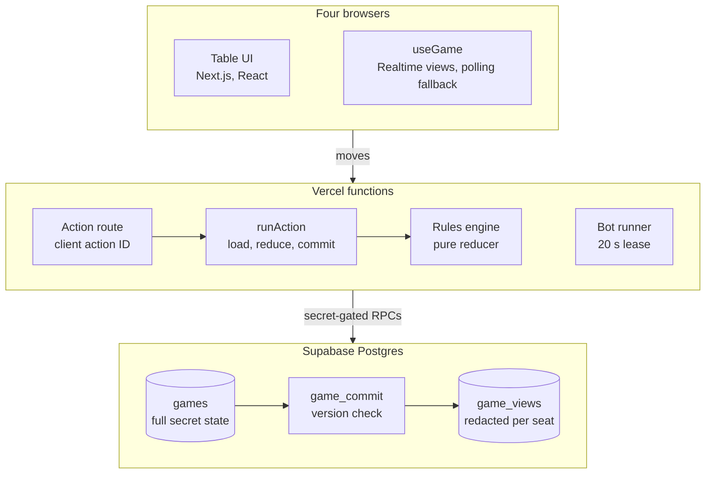
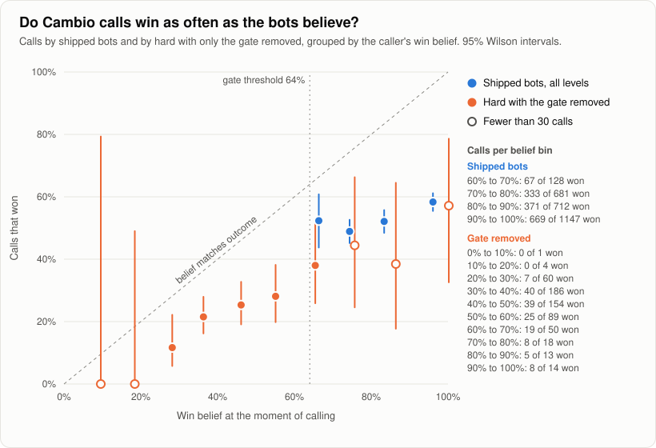

<p align="center">
  <picture>
    <source media="(prefers-color-scheme: dark)" srcset="docs/logo/screens/logo-180-dark.png">
    
  </picture>
</p>

# Cambio

**The memory card game Cambio (also called Cabo), live in the browser with friends or three house bots.** Remember four face-down cards, swap and stick your way down, and call Cambio when you think your hand is the lowest at the table.

**[Play it → cambio.bhanusadhu.com](https://cambio.bhanusadhu.com)** · play as a guest in seconds, or make an account to keep your record.


## The problem

Cambio is a favourite with friends because it mixes memory, bluffing and quick reactions, but it needs a physical deck and four people in one room. Online card sites rarely have it, and the ones that do can't fill a table when only one or two friends are around. Bots in casual card games are usually either hopeless or quietly cheating, since the code can see every card.

The goal: **a full four-seat table in one click, with bots that play fair and play at a level you choose.**

## How it works

1. **Open a table.** Pick a name and an avatar and share the five-character code. Seats nobody takes go to Cameron, Camila and Cami, each set to easy, medium or hard.
2. **Peek.** Four cards land face down at every seat. When everyone says they're ready, each player sees their own bottom two for five seconds.
3. **Draw and decide.** Swap the drawn card into your hand, push it onto an opponent, or place it on the pile to use its power: peek at your card or someone else's, blind-swap two players' cards, or look at two and choose.
4. **Stick.** Anyone can slap down a card that matches the top of the pile at any moment, even on someone else's turn. Wrong guesses cost a penalty card.
5. **Call Cambio.** Everyone else gets one last turn, then hands are scored. Lowest total wins: a red king is −1, a black king or joker 0, an ace 1, faces 10.

In the demo, Ace's final hand is J♣, a joker, K♦ and K♠: 10 + 0 − 1 + 0 = **9**, the lowest at the table, so the call wins.

## Product decisions

| Decision | Trade-off |
| --- | --- |
| **House bots fill every empty seat** | Three difficulty levels had to be built and measured. In return one person can play a real four-seat round right away, and friends can join the next round. |
| **Guests first, accounts optional** | A guest's results aren't saved. But nobody has to sign up to try it, and creating an account mid-round keeps the same seat, hand and avatar. |
| **Sticking is open at every moment, including your own turn** | It complicates the turn logic (the table arms the stick when the turn already owns the click). The old rule took away the one reaction the game runs on from whoever was mid-turn. |
| **Difficulty means how often a bot plays its best, not what it can see** | Easy plays its full strategy on 50% of decisions, medium 75%, hard 100%, all with the same legal information as a human. That is harder to tune than letting hard peek, but it is fair and measurable. |
| **Learned bot policies stay off** | Trained models made medium and hard stronger on test seeds. They stay off because with them live, hard skipped a blind swap that wins the round and an existing test failed, and the learned call model called on hands it should have known were lost. |
| **No game server** | Every move is a short serverless function plus a version-checked write in Postgres, which makes concurrency the hard part. In return there is nothing to keep running between games. |

## Architecture



The rules live in one deterministic reducer with time, randomness and IDs injected, so the UI and server never reimplement a rule. The full game state, every card included, sits in a Postgres row the browser can't read. Each player receives only the view `view.ts` lets them see, streamed back over Supabase Realtime. → [docs/architecture.md](docs/architecture.md), [docs/engine.md](docs/engine.md)

## Hard problems

**Four players acting in the same instant.** Two sticks can land in the same few milliseconds. Each action loads the state and its version, runs through the engine, and commits only if the version hasn't moved (`game_commit`). The loser reloads and runs again against the winner's state, so the rules decide the late action ("too late", no penalty). Client-generated action IDs stop a retried request from applying twice, and views older than the one a browser holds are discarded. → [`src/lib/server/store.ts`](src/lib/server/store.ts)

**Hiding cards from the people holding the browser.** The `games` table has row-level security on and no policies, so the browser's key can't read it at all. Every server read and write goes through `SECURITY DEFINER` functions that need a shared secret. Reshuffled discards get new IDs so they can't be traced back into the deck, and the table narration carries card IDs, never ranks. → [`src/lib/game/view.ts`](src/lib/game/view.ts)

**Bots that can't cheat.** Each bot decides from a separate observation holding only what its seat legitimately saw. Fairness tests swap the hidden cards, reverse the deck and replace opponents' private knowledge, then check the bot's moves don't change. Other tests throw on any attempt to read a secret. → [`src/lib/game/bot-observation.ts`](src/lib/game/bot-observation.ts)

**Measuring strength honestly.** Bot changes were tested with pre-registered hypotheses over 800 rounds per matchup on fresh seeds. The evaluation found the bots overconfident: calls made at an average **87.0%** belief won only **54.0%** of the time (1,440 of 2,668). The call gate still earns its place, since a hard bot without it won only **44.4%** against full hard bots. → [the bot evaluation](docs/experiments/bot-evaluation.md)

<p align="center"></p>

## Results

- **384** unit tests across 36 files. They pin every rule (ready check, anytime sticks, final-turn sticks, zero-card endings, scoring with red kings and jokers), bot fairness and memory limits, and the difficulty ordering. They also fail on any unfinished round, illegal move, or lost or duplicated card.
- **29** Playwright specs, including final scores and zero-card endings checked in four live browsers, host handoff, guest-to-account seats, presence and friends.
- **Bot ladder**, 800 rounds per matchup with 95% intervals:

| Matchup | Owner's target | Live bots |
| --- | --- | --- |
| Easy vs a beginner reference player | 45% to 85% | **55.2%** (52.2% to 58.2%), met |
| Medium vs a beginner reference player | 65% to 95% | **73.7%** (71.1% to 76.3%), met |
| Hard vs a beginner reference player | at least 85% | **78.4%** (75.9% to 81.0%), missed |
| Hard vs medium | 55% to 75% | **63.0%** (59.9% to 66.1%), met |
| Medium vs easy | 65% to 90% | **80.2%** (77.6% to 82.9%), met |

The beginner is a reference player that only exists in the evaluation: it remembers its opening peek, swaps in lower cards, and never sticks or uses powers. Hard misses its target against it. The learned action policy reaches 84.8% there, still just short, and stays off for the reasons above. Not measured: how real players rate the bots, or how long they keep playing. There is no analytics.

## How it was built

1. **Engine first.** The rules engine, the real-time backend, a first bot and the table UI all landed in the first commit.
2. **A social layer.** Profiles, a permanent record of every scored round, friends, presence, invites, a leaderboard and seven rank tiers.
3. **Rules shaped by playtests.** Sticking opened to every seat at every moment, the round start became deal, then ready check, then peek, and final-turn sticks got a window so a run of matches isn't cut off.
4. **Bots, measured.** Three levels became shares of full-strength play, each bot got its own observation, and the bot docs were audited against 300 instrumented rounds: every claim the audit could measure held.
5. **Learned policies, tried and kept off.** Call and action models trained from rollouts, run in plain TypeScript, tested once on fresh seeds, and left disabled when they broke an existing test.
6. **Polish.** Four-browser final-score checks, the card-arc logo, and red suits redrawn to hold 4.5:1 contrast.

## Tech stack

| Layer | Technology |
| --- | --- |
| App | Next.js (App Router), React, TypeScript, Tailwind CSS |
| Data and real time | Supabase Postgres, Realtime, `SECURITY DEFINER` RPCs |
| Server | Vercel functions, bot runner via `waitUntil` |
| Bot training | Python (NumPy, scikit-learn), models exported to a TypeScript forward pass |
| Testing | Vitest, Playwright |

## Run it locally

```bash
npm install
npm run dev              # http://localhost:3000
npm test                 # unit tests: engine, bots, views, server
npx playwright test      # browser specs
npm run results          # regenerate the bot evaluation (CSV + charts)
```

Copy the Supabase keys and `CAMBIO_SERVER_SECRET` into `.env.local` (the secret must match `private.server_config.server_secret` in the database), and apply `supabase/migrations`. Pushes to `main` deploy on Vercel.

## Project structure

```
src/lib/game/        # Rules engine, bots, bot observations, redacted views
src/lib/server/      # runAction with version-checked commits, bot runner, social writes
src/lib/client/      # useGame hook, Realtime subscription, watchdog, card animations
src/components/      # Table UI, profile cards, friends panel
supabase/            # Schema, migrations and RPCs
scripts/             # Bot evaluation, ML data collection, ladders and audits
ml/                  # Training for the learned policies (Python)
e2e/                 # Playwright specs
docs/                # Rules, architecture, engine, bots, decisions, experiments
```

## What's next

Known limits:
- Hard bots fall short of the 85% target against a beginner.
- Bot beliefs are decision estimates, not calibrated odds.
- There is no matchmaking with strangers; tables are joined by code or invite.

Next: tune hard against the beginner target without breaking the existing tests, recalibrate the call beliefs, and measure how real players rate each level.

[How to play](docs/how-to-play.md) · [Architecture](docs/architecture.md) · [Engine](docs/engine.md) · [Bots](docs/bots.md) · [Accounts](docs/accounts.md) · [Decisions](docs/decisions.md) · [Bot evaluation](docs/experiments/bot-evaluation.md)
