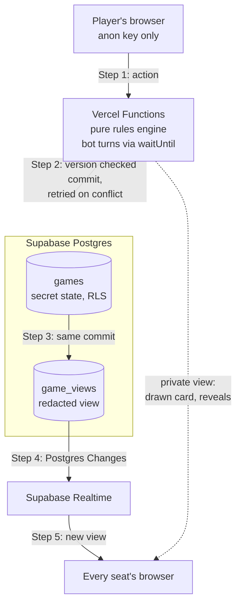
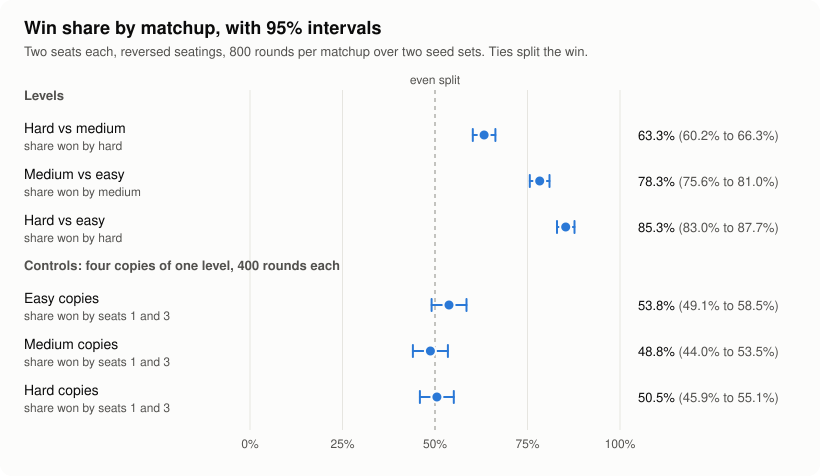
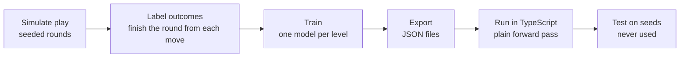

<p align="center"></p>

# Cambio

[](https://github.com/bhnsadhu/cambio/actions/workflows/ci.yml)
[](https://cambio.bhanusadhu.com/leaderboard?scope=all)

A real time multiplayer web app for the card game Cambio, where house bots that see only what a human could see fill every empty seat.

**Play it live: [cambio.bhanusadhu.com](https://cambio.bhanusadhu.com)**


*One full round against the three house bots, sped up about seven times. Recorded on the local test database, not the live site.*

## At a glance

* **A full product.** A live multiplayer card game for four seats, playable in the browser as a guest or with an account that keeps wins, rank, streak, friends and a leaderboard position. It runs on serverless functions and one Postgres database, with no dedicated game server.
* **Built to be correct.** A pure rules engine decides every move, commits are version checked so simultaneous moves cannot overwrite each other, hidden cards never leave the server, and seeded bot tables, unit tests and a browser suite run in CI on every push.
* **Plus a measured look at its bots.** House bots fill empty seats at three levels. The levels are ordered and every documented behavior the audit could measure held. The bots' Cambio calls are overconfident. Models trained on simulated games improved some measures, but both learned parts stay off for real players because existing safety tests fail with them on.

Every bot number below comes from bots playing bots. No human played in any of those tests.

## What is built

| Feature | What it does |
| --- | --- |
| **Real time multiplayer** | Every move streams to all four seats over Supabase Realtime. Simultaneous moves are serialized, and the rules decide every late arrival. |
| **Complete game engine** | Turn logic, power cards, anytime sticking, and every way a round can end, in pure TypeScript with no I/O. |
| **Bots that play from memory** | Three house bots fill empty seats and act only on information they have legitimately seen, at three difficulties. |
| **Persistent accounts** | Wins, rank and streak across every table, with friends, invites and a light for whoever is playing right now. |
| **Friends and global leaderboards** | Compare lifetime points with accepted friends or all players. Equal points share a rank, and your position stays visible even outside the current page. Guests can browse the global leaderboard. |
| **Serverless architecture** | Runs on serverless functions and one Postgres database, with no dedicated game server. |
| **Learned bot policies, not live** | Per level call and action models trained from rollouts of seeded play, with features limited to what each level may know, a plain TypeScript forward pass, and hypotheses written before any model code. They stay off until a test run supports them, and none has yet. |
| **Engine and browser regression suites** | Seeded bot versus bot tables played to the score, checking that every move is legal, no card is created or lost, and each difficulty beats the one below it. A Playwright suite covers the whole account lifecycle against an isolated database. |

## Architecture



Every move is a pure function over the current state. The server loads the state and its version, runs the action through the engine, and commits only if the version is unchanged; a losing commit reloads and runs again, so the rules decide every late arrival. More in [docs/architecture.md](docs/architecture.md).

## Engineering

* **Real time sync.** Committed, redacted views stream to all four seats over Supabase Realtime. Clients discard any view older than the one they hold, and slow polling plus a refresh on tab focus recover from dropped sockets. Client generated action IDs stop a retried request from applying twice.
* **A pure rules engine.** Every move is a function over the current state: `applyAction(state, envelope, ctx)` returns a new state or an error, in TypeScript with no I/O.
* **Version checked commits.** The server loads the state and its version, runs the action through the engine, and commits inside Postgres only if the version is unchanged. A losing commit reloads and runs again, so the rules decide every late arrival. Bot turns run on the same path: after every human action the server starts a bot runner with `waitUntil`, and a 20 second database lease keeps it to one runner per game.
* **Hidden information stays hidden.** The full state lives in one row with Row Level Security enabled and no policies. The browser holds only the anon key and can read only the redacted `game_views`. Tests permute every unseen card, reverse the deck, and throw on any attempted read of a card a bot has not seen, and the bots' plans must not change.
* **Tests and CI.** Seeded bot versus bot tables play to the score and check after every action that the move was legal and all 54 cards are accounted for. Vitest covers the engine and bots, and a Playwright suite covers the whole account lifecycle against isolated Postgres containers. GitHub Actions runs typecheck, lint, the unit tests and the account suite on every push and pull request, with no real secrets.
* **Accounts and sessions.** Passwords use salted scrypt hashes. Session tokens live in HttpOnly cookies with SameSite protection and only their hashes are stored, and login and sensitive changes have persistent request limits. Guests can play without an account.

More in [docs/architecture.md](docs/architecture.md).

## Product decisions

**The game**

* **The ready check comes after the deal.** It used to run before the deal, on a screen of its own with nothing on the table, which the commit called "the wrong half of the sequence." The round now deals, checks that every seat is ready, then opens the peek.
* **Sticking is open to every seat at every moment.** The old rule refused a stick from the player mid turn, which, in the commit's words, "took the one reaction the game runs on away from whoever was mid turn."
* **Sticking stays open through the final turn.** The round used to score the instant the last final turn ended, so "a player who stuck one match and reached for a second lost the round out from under them." It now holds the round open on a short window, and an incorrect stick does not prolong it.
* **The table narrates itself.** Playtesters "could follow their own moves and nobody else's," so one announcement at a time now names the move, who made it and whose card it touched.
* **Pausing and playing again need the whole table.** Any player can ask to pause and every seat answers, and another round starts only when every seat asks. The decisions log gives the purpose as inferred, not stated: one player should not decide for everyone else.

**The bots and their evaluation**

* **The hypotheses were written before the code.** The evaluation document was committed before any evaluation code, and the learned policy hypotheses before any model, training or data logging code. Mistakes get a dated correction note underneath instead of an edit.
* **The rule for going live was fixed in advance.** Each switch is one constant, and the rule says which results must hold before it moves. The outcome was decided by the rule, not by how the result looked afterward.
* **The switch was not forced when a safety check failed.** The tuned setting passed the strength, order, identity, call, legality and speed checks and failed one existing behavior test. Nothing went live, and neither the test nor the model was changed to get past it.
* **The second rule was written after seeing the first run, and says so.** Easy missed H6 by three hundredths of a point, so nothing went live. To keep the new rule honest, only each level's action mix was tuned, on validation seeds only, and the result was tested once on fresh seeds that are locked after a single use.
* **Bots only see what a human could see.** Each bot receives a separate observation holding only its own seat's knowledge, and tests change hidden faces, reverse the deck and give other seats false knowledge without changing any move. The decisions log records the purpose as inferred, not stated: a bot should not use information a human at the table could not see.
* **Documentation follows the measurement.** When the evaluation showed the calls won 54.0% against a 64% gate, the bot doc stopped calling the Cambio rule cautious. For the audit the rule was set in advance: if a measured behavior contradicts a claim, the documentation is corrected and the bots are not changed to match it.

## Bot research

The house bots also come with a written evaluation, kept short here. Every hypothesis was pre registered: written and committed before the code that tests it. The long tables are in the collapsed sections below, the full write up with every interval and what was not measured is in [the bot evaluation](docs/experiments/bot-evaluation.md), and `npm run results` regenerates every number and chart.

**The question.** Can bots that only see what a human could see play at three clearly different skill levels, and can their Cambio calls be trusted?

**The answer: the levels, yes; the calls, no.** Over 800 seeded rounds per matchup, hard won 63.3% of the win share against medium (95% interval 60.2% to 66.3%), and medium won 78.3% against easy (75.6% to 81.0%). Every call by the shipped bots cleared a 64% belief gate and the average belief was 87.0%, but only 54.0% of the calls won (1,440 of 2,668).



**Trained models.** Models trained on simulated games, evaluated once on held out test seeds, gave Cambio calls with far better calibrated stated chances (calibration error 0.086 against the gate's 0.310) and made medium and hard stronger against their frozen selves (54.7% and 58.8% of the win share). The levels kept their order and their identity. Learned actions did not clear the bar for easy, and the call model calls on hands it should know are lost when a position is far from its training data. Details in the collapsed sections below, [the learned policy results](docs/experiments/bot-evaluation.md#learned-policies-results) and [ml/README.md](ml/README.md).

**What real players get: the original bots at every level.** Neither learned part is live.

* **Learned actions are off** because the per level switch failed an existing behavior test: with the tuned mix live, hard skips a blind swap that the frozen rules use to take the lead, and the rule written before the run requires every existing test to pass.
* **Learned calls are off** because switching them on fails existing tests that every live bot must pass: with learned calls, all three levels call Cambio on a hand they know is losing.

<details>
<summary>Results at a glance: all fifteen hypotheses</summary>

Fifteen hypotheses, each written before the code that tests it. Verdicts follow the rules fixed in advance in [the bot evaluation](docs/experiments/bot-evaluation.md). Intervals are 95% intervals.

| | Hypothesis in plain words | Verdict | Key number |
| --- | --- | --- | --- |
| H1 | Hard beats medium, and medium beats easy | **Supported** | Hard 63.3% (60.2% to 66.3%) against medium; medium 78.3% (75.6% to 81.0%) against easy |
| H2 | Cambio calls win as often as the 64% gate requires | **Refuted** | Calls won 54.0% (52.1% to 55.9%) at an average belief of 87.0% |
| H3 | Each ability (memory, card counting, inference from public keeps, the call gate) adds strength | **Supported** for all four | Hard without it won 37.6% (memory), 47.1% (counting), 44.6% (inference), 44.4% (gate) against full hard |
| H4 | The test is fair | **Supported** | Copies of one level split wins evenly within their intervals; seat order changed no result |
| H5 | The learned call model states truer chances than the gate | **Supported** | Calibration error 0.086 against 0.310 |
| H6 | Learned actions beat the frozen version at every level | **Refuted** for easy | Easy 52.8% (49.97% to 55.6%); medium 54.7% (51.6% to 57.7%); hard 58.8% (55.6% to 61.9%) |
| H7 | The level order survives the learned policies | **Supported** | Hard beat medium 63.3% to 68.6%; medium beat easy 78.0% to 83.1%; every interval clear of 50% |
| H8 | No learned policy uses information its level should not have | **Supported** | Every hidden information test passes for every level |
| H9 | Each level keeps its identity | **Supported** | Closest case: medium with learned actions against frozen hard, 40.9% (38.0% to 43.8%) |
| H10 | No level is worse than its frozen self at the tuned mix | **Supported** | Easy 52.8% (49.9% to 55.6%), medium 60.5% (57.5% to 63.5%), hard 56.5% (53.4% to 59.6%) |
| H11 | The levels stay ordered at the tuned mix | **Supported** | Hard against medium 58.8% (55.5% to 62.1%); medium against easy 82.6% (80.3% to 85.0%) |
| H12 | The levels keep their identity at the tuned mix | **Supported** | Easy against frozen medium 21.0% (18.3% to 23.8%); medium against frozen hard 45.7% (42.4% to 48.9%) |
| H13 | The tuned mix is safe and fast enough to go live | **Refuted** | One existing test failed: hard skips a blind swap the test requires. Speed passed: 3.50 ms at the 99th percentile against a 25 ms bound |
| H14 | The live bots behave as documented | **Partly** | Every claim the audit could measure held; reaction speed was not measured validly |
| H15 | The owner's strength targets are met | **Partly** | Live bots meet four of five; hard against the beginner is missed at 78.4% (75.9% to 81.0%) |

**What survived.** The three levels are ordered and distinct, each ability earns its place, and the test setup is fair. A learned call model can state truer chances, and learned actions helped medium and hard. **What did not.** The shipped Cambio calls are overconfident, learned actions for easy missed the bar, and the tuned setting failed one safety test, so nothing went live.

</details>

<details>
<summary>How the levels were tested</summary>

* **Seeded rounds.** Each test plays complete rounds from a numbered seed, so the same seed deals the same cards and any result can be replayed exactly.
* **Seats swapped.** Two sides share a table, two seats each. Every seed is played twice with the seating reversed, so neither side gets a better chair.
* **Copies of one level against itself.** Four copies of the same level should split the wins evenly. They did, within their intervals (H4).
* **Abilities removed one at a time.** A hard bot loses one ability (memory, card counting, inference from public keeps, or the call gate) and plays full hard bots. If it gets weaker, the ability matters (H3).

Together these make the comparison fair: the same deals, the same chairs, the same rules engine, and a known baseline for what an even split looks like. Matchups run 800 rounds over two independent seed sets, and a 95% interval says how far chance alone could move each result.

This is bots against bots. No human played in any of these tests. The beginner player used in the ladder below exists only inside the tests and never sits at a live table.

</details>

<details>
<summary>Do the levels play as designed? Documented versus measured and the ladder</summary>

The documented behavior of each level, measured from 300 instrumented bot rounds on fresh seeds ([audit](docs/experiments/bot-evaluation.md#h14-the-frozen-bots-measured-against-the-docs)). Real players get the frozen bots (C0), the original policies.

| Documented | Easy | Medium | Hard |
| --- | --- | --- | --- |
| Share of opportunities played with the full strategy (50%, 75%, 100%) | 49.9% (49.2% to 50.7%) | 75.1% (74.4% to 75.7%) | 100% (16,377 of 16,377) |
| Memory: easy its two latest cards, medium its own cards plus six opponent cards, hard everything it has seen | Never more than 2 faces | Never more than 3 opponent faces, no own face forgotten | No seen face forgotten while on the table |
| Easy misses sticks | Missed 55.3% of the sticks its full strategy would make | 27.3% | 0% |
| Easy skips useful powers | Skipped 52.8% of the powers its full strategy would use | 29.9% | 0% |
| Easy sometimes keeps a draw without checking | 641 such keeps | 270 | 0 |
| Easy reacts slowest, hard fastest | **Not measured validly** | | |

All measurable claims held. **The one claim not measured validly is reaction speed.** The audit's instrumentation reported each seat's planned actions together with the plans of seats planned after it in the same pass, so delays were mixed across levels. Hard's mean planned draw delay came out at 2.65 seconds, above the 2.38 seconds hard can plan at all, so all six delay checks of that run are void. The bug was in reporting only, it is fixed, and the audit seeds are spent, so reaction speed stays unmeasured. What the code sets, which is not a measurement: every decision delay is scaled by 1.35 for easy, 1 for medium and 0.7 for hard.

Next, the levels against each other and against a beginner reference player (keeps only its opening peek, never sticks or uses powers, and calls when its known cards total 2 or less). Each matchup is 800 rounds on fresh seeds, with the owner's target ([ladder](docs/experiments/bot-evaluation.md#h15-the-owner-targets)). A target is **Met** when the result lies inside the range, **Marginal** when it lies outside but its interval reaches the range, and **Missed** otherwise.

| Matchup | Target | Live bots (C0) | With the tuned learned actions (A*, not live) |
| --- | --- | --- | --- |
| Easy vs beginner | 45% to 85% | 55.2% (52.2% to 58.2%), **Met** | 56.4% (53.5% to 59.4%), **Met** |
| Medium vs beginner | 65% to 95% | 73.7% (71.1% to 76.3%), **Met** | 78.5% (76.0% to 81.0%), **Met** |
| Hard vs beginner | at least 85% | 78.4% (75.9% to 81.0%), **Missed** | 84.8% (82.6% to 87.0%), **Marginal** |
| Hard vs medium | 55% to 75% | 63.0% (59.9% to 66.1%), **Met** | 58.8% (55.5% to 62.1%), **Met** |
| Medium vs easy | 65% to 90% | 80.2% (77.6% to 82.9%), **Met** | 82.6% (80.3% to 85.0%), **Met** |

The live bots miss the hard against beginner target by more than six points, and neither configuration reaches 85% on the point estimate.

</details>

<details>
<summary>Trained bot models: pipeline, speed and what it found</summary>



The models learn from simulated rounds. At each sampled decision, every candidate move is tried on a copy of the true state, the undealt deck is shuffled, and the frozen bots play the rest of the round, several times. Each level's model sees only what that level may know. Two kinds were trained: a call model (does calling Cambio now win?) and an action model (which move is best?).

**What it found.** The call model is far better calibrated than the gate (0.086 against 0.310, H5), but better calibration did not mean better calls: its calls won 48.7% against the gate's 55.6%. Learned actions made medium and hard stronger and not clearly easy (H6). The tuned per level mix (easy 0.5, medium 1, hard 0.75) hurt no level, but it failed one safety test (H13).

**Decision speed.** One learned action decision took a mean of 0.29 ms and 3.50 ms at the 99th percentile, over 14,522 decisions, against a bound of 25 ms (hard's 99th percentile was 5.22 ms, the slowest single decision 14.51 ms). This was timed on a 4 core cloud container. Nothing measures speed inside the Vercel functions or under real traffic ([ml/README.md](ml/README.md#speed)).

**The first two answers in full.**

**Can models trained on simulated play do better? Partly, and none of it is live.** Per level models, trained only on what each level may know and evaluated once on untouched test seeds, gave Cambio calls whose stated chances are far closer to the truth (calibration error 0.086 against the gate's 0.310) and made medium and hard stronger against their frozen selves (54.7% and 58.8% of the win share). The levels kept their order and their identity. But learned actions did not clear the bar for easy (its interval reached 49.97%), and the call model calls on hands it should know are lost when a position is far from its training data. Details in [the learned policy results](docs/experiments/bot-evaluation.md#learned-policies-results) and [ml/README.md](ml/README.md).

**Can each level switch to learned actions on its own? Not yet.** After that first run, the owner allowed each level to go live separately. That rule was written after seeing the first run, so the only thing tuned was each level's action mix (the share of its focused decisions that use its learned action model), on validation seeds only, and the result was tested once on fresh seeds. With easy at 0.5, medium at 1 and hard at 0.75, no level did worse than its frozen self, the levels stayed ordered, and none reached the frozen level above it. But one existing behavior test fails with that setting live: in a test position, hard skips a blind swap that the frozen rules use to take the lead. The rule written before the run requires every existing test to pass, so nothing went live and every level still plays the original policies. Details in [the per level results](docs/experiments/bot-evaluation.md#per-level-go-live-results).

**What real players get, in full.**

**The original bots, at every level** (call policy `gate_v1`, action policy `rules_v1`). Both learned parts remain in the code as options, set per level in `src/lib/game/bot-policies.ts`.

* **Learned actions stay off.** The per level switch failed H13, and before it H6 was refuted for easy. With the tuned mix live, one existing behavior test fails: `can use a blind swap entirely between opponents to take the lead`. In its fixture the frozen rules use a jack's blind swap between two opponents to take the lead, and hard with learned actions skips the power instead. The rule written before the run requires every existing test to pass. Whether the test or the model is right about that position was not examined, and neither was changed.
* **Learned calls stay off.** Switching them on fails existing tests that every live bot must pass: with learned calls, all three levels call Cambio on a hand they know is losing. In the test fixture the bot holds 6 points it has seen, one opponent holds a single card worth 0, and the gate's own win belief is 0%; the call model gives 88% (easy), 98% (medium) and 98% (hard). The logistic model extrapolates badly in positions far from its training data. In the test run, 24 of the model's 3,071 calls came at a gate belief below 10%, and 3 of them won.

</details>

<details>
<summary>Corrections and what did not work</summary>

* **Guarantee tests were not run before the test run.** The learned policy tests covered legality, card conservation, memory and hidden information, but not the gate's behavioral guarantees (never call on a known losing hand, respect unknown cards). Those tests only ran against the learned calls after the single test run, when the live switch was tried, and by then the test seeds were used.
* **Better calibration did not mean better calls.** The model's stated chances are much closer to the truth, but it calls more often and in worse positions than the gate. 47.6% of its calls came at a gate belief below 64%, and those won 41.3%.
* **Easy's learned actions missed the bar.** Its interval started at 49.97%, three hundredths of a point from an even split. At the tuned mix of 0.5 it again starts just below 50%, so the data does not show that learned actions make easy stronger, only that they do not make it measurably weaker.
* **The blind swap check failed.** One existing behavior test fails with the tuned mix live, so H13 was refuted and nothing went live.
* **The reaction speed audit was voided.** A reporting bug in the new instrumentation mixed planned delays across levels. Bots never read the report, but the six delay checks of the single run mean nothing, and the seeds are spent.
* **The first push of the instrumentation broke CI.** An existing test that runs close to its 30 second limit (27.8 seconds before this work) timed out at 32.8 seconds under the extra test load. Both commits were reverted at once and the work landed again with lighter tests, after which the same test took 28.7 seconds on CI. It has little margin either way, so `bots.test.ts` now runs in a test group of its own after every other file, with its limits and assertions unchanged.
* **The Cambio gate is overconfident.** Calls believed to win 64% to 100% of the time won about half the time. The gate still adds strength as a filter (H3), but its percentages should not be read as probabilities.
* **The best informed level makes the worst calls.** Hard's calls won 51.5%, against 62.3% for easy. Why was not measured.
* **Smaller misses.** Choosing among the top two moves to make medium less sharp cost far too much (42.0% against frozen medium on validation). The rollout labels are noisy, with 4 rollouts per candidate, so the frozen rule and the models both picked the best move only about a third of the time.

</details>

<details>
<summary>What is next, not done</summary>

Taken from the evaluation's own lists of what was not measured. None of these has been done.

* **Not done: a guarded call model.** Adding the gate's guards to the call model, or retraining it to stay sane far from its data, was not tested, because there are no unused test seeds left for it.
* **Not done: a per level switch tested on fresh seeds.** The tuned mix was tested once and its seeds are spent, so a later switch, one level at a time, needs new seeds.
* **Not done: human versus bot play.** Every number here is bots playing bots, and whether the gaps between levels hold against people, or how the levels feel to play, is unknown.

</details>

## Tech Stack

| Component | Technology |
| --- | --- |
| Framework | Next.js 16 with the App Router |
| UI | React 19 |
| Language | TypeScript |
| Styling | Tailwind CSS 4 |
| Database | Supabase Postgres |
| Real time sync | Supabase Realtime |
| Database security | Row Level Security and `SECURITY DEFINER` RPCs |
| Hosting and compute | Vercel Functions, with `waitUntil` running bot turns after the response is sent |
| Animation | Web Animations API, with no animation library |
| Testing | Vitest, Playwright, and isolated Postgres lifecycle checks |
| Continuous integration | GitHub Actions, with no real secrets |
| Typography | Plus Jakarta Sans |

## Measured and not yet measured

**Measured** (bot versus bot, regenerated by `npm run results`; each result links to its section of [the bot evaluation](docs/experiments/bot-evaluation.md))

* Level ordering: hard won 63.3% against medium and medium 78.3% against easy, over 800 rounds per matchup and two independent seed sets ([H1](docs/experiments/bot-evaluation.md#h1-the-three-levels-are-clearly-ordered-supported)).
* Which abilities matter: against full hard bots, a hard bot won 37.6% with only two remembered cards, 47.1% without card counting, 44.6% without inference from public keeps, and 44.4% without the call gate ([H3](docs/experiments/bot-evaluation.md#h3-each-ability-adds-strength-supported-for-all-four)).
* Call calibration: the shipped bots' calls won 54.0% at an average belief of 87.0%, and no belief bin came within 15 points of its belief ([H2](docs/experiments/bot-evaluation.md#h2-the-cambio-gate-refuted), [chart](docs/images/calibration.svg)).
* Fairness controls: four copies of one level split the wins evenly within their intervals, and seat order changed no result ([H4](docs/experiments/bot-evaluation.md#h4-the-harness-is-fair-supported)).
* The original seeded benchmark still reproduces exactly (hard 64.5 win shares to medium's 31.5, medium 82.5 to easy's 13.5), and every round finishes with only legal moves and all 54 cards accounted for after every action ([defaults check](docs/experiments/bot-evaluation.md#results)).
* Hidden information: tests permute every unseen card, reverse the deck, and throw on any attempted read of a card a bot has not seen, and the bots' plans must not change ([H8](docs/experiments/bot-evaluation.md#h8-no-learned-policy-uses-information-its-level-should-not-have-supported)).
* Learned policies, once on 400 untouched test seeds: the call model's calibration error was 0.086 against the gate's 0.310 (H5 supported) but its calls won 48.7% against the gate's 55.6%; learned actions beat their frozen level for medium (54.7%) and hard (58.8%) but not clearly for easy (52.8%, 49.97% to 55.6%), so H6 is refuted; order, identity and hidden information held (H7, H9 and H8 supported) ([results](docs/experiments/bot-evaluation.md#learned-policies-results), [chart](docs/images/learned-win-share.svg)).
* A per level go live, tuned on validation seeds and tested once on fresh seeds: no level did measurably worse than its frozen self (easy 52.8% with an interval from 49.9%, medium 60.5%, hard 56.5%), order and identity held (H10, H11 and H12 supported), and a learned action decision took 3.50 ms at the 99th percentile, but one existing behavior test fails with that setting live, so H13 failed and nothing went live ([results](docs/experiments/bot-evaluation.md#per-level-go-live-results)).
* The frozen bots matched every documented claim the audit could measure. Reaction speed was not measured validly ([H14](docs/experiments/bot-evaluation.md#h14-the-frozen-bots-measured-against-the-docs)).
* What real players get: the original bots, `gate_v1` and `rules_v1` at every level, with both learned parts left in the code as options set per level in `src/lib/game/bot-policies.ts` ([the decision and its results](docs/experiments/bot-evaluation.md#per-level-go-live-results)).

**Not yet measured**

* Any human versus bot play.
* Load, latency, or behavior under real traffic beyond the concurrency races the tests stage.
* Calibrated calls that are also safe. The learned call model is better calibrated but extrapolates badly far from its data; a guarded version was not tested, because the test seeds have been used.
* Whether the learned policies feel right or fun to people.
* Reaction speed by level. The audit's delay checks were void, and the seeds are spent.
* Full games to a score. The evaluation plays single rounds at equal reaction speeds.
* Phone play. The table is built and tested for laptop and desktop windows.

## Run It Locally

You need a Supabase project.

### 1. Set up the database

Apply the migrations, in order:

```text
supabase/migrations/0001_cambio_schema.sql
supabase/migrations/0002_social.sql
supabase/migrations/0003_presence_invites.sql
supabase/migrations/0004_accounts.sql
supabase/migrations/0005_usernames.sql
supabase/migrations/0006_table_join_requests.sql
supabase/migrations/0007_social_resends.sql
supabase/migrations/0008_room_do_not_disturb.sql
supabase/migrations/0009_leaderboard.sql
supabase/migrations/0010_browser_presence.sql
supabase/migrations/0011_profile_avatars.sql
supabase/migrations/0012_avatar_skin_tones.sql
supabase/migrations/0013_live_presence.sql
```

Then store a server secret:

```sql
insert into private.server_config(key, value)
values ('server_secret', '<hex>');
```

Replace `<hex>` with your server secret.

### 2. Install dependencies and configure the environment

```bash
npm install
cp .env.example .env.local
```

Fill in `.env.local` with your Supabase URL, anon key, and server secret.

| Setting | Purpose |
| --- | --- |
| Supabase URL | Connects the app to your Supabase project |
| Supabase anon key | Allows browser access to permitted game views |
| `CAMBIO_SERVER_SECRET` | Must match the `server_secret` value stored in `private.server_config` |

### 3. Start the app

```bash
npm run dev
```

### 4. Run the tests

```bash
npm run typecheck
npm run lint
npm test
```

For the complete account lifecycle, start Docker and install the test browser once:

```bash
npx playwright install chromium
npm run test:accounts
```

This command creates isolated Postgres and PostgREST containers, applies every migration, runs the SQL account tests, starts a local app using dummy credentials, and runs the browser suite. It removes the test containers afterward. Stop any existing Next development server first so the test app can use the development build directory.

The browser suite covers registration, duplicate usernames, display name changes at active tables, username changes, wrong and correct passwords, session revocation, logout, a failed logout request, delayed responses after logout, multiple tabs, legacy profile upgrades, restored stats and friends after clearing storage, seat recovery, permanent deletion, request origin checks, and the account and login pages in a 390 pixel wide window without sideways scrolling. The same run also covers gameplay, bots, presence, notifications, seat management, and the table at laptop window sizes. These tests never use the live Supabase database.

Continuous integration runs all of the above on every push and pull request; see [.github/workflows/ci.yml](.github/workflows/ci.yml).

### 5. Regenerate the bot evaluation

```bash
npm run results
```

This deletes and rewrites every file in `results/` and the three charts in `docs/images/`, then prints how long it took. It first replays the original seeded benchmark and stops if that no longer reproduces, then plays 6,800 seeded bot rounds across all CPU cores. The output is deterministic: runs with different worker counts wrote byte identical files. It needs Node 24 and no extra packages, since Node runs the TypeScript directly.

### 6. Retrain the bot models

```bash
npm run ml:data -- --split train --seeds 200
npm run ml:data -- --split validation --seeds 100
python3 -m venv ml/.venv && ml/.venv/bin/pip install -r ml/requirements.txt
cd ml && .venv/bin/python train_call.py && .venv/bin/python train_action.py && cd ..
npm run ml:tune -- --thresholds
npm run ml:tune -- --check
```

Collecting the data took 21 and 11 minutes on 4 cores. The models land in `src/lib/game/models/` and the tests check the TypeScript forward pass against them. Retrained models need fresh test seeds before any claim about them, since the current ones have been used. [ml/README.md](ml/README.md) has the data schema and every validation number.

### 7. The per level go live runs

```bash
npm run ml:speed          # time per learned action decision, validation seeds
npm run ml:tune-mix       # choose each level's action mix, validation seeds
npm run audit:levels      # the frozen bots against the docs, seeds 540001 to 540050
npm run ml:ladder         # C0 and A* against each other and the beginner
npm run ml:evaluate-live  # each A* level against its frozen self and the level above
```

Each prints its wall time and plays on the same worker pool as `npm run results`. On a 4 core cloud container they took 5.2, 263.9, 12.3, 187.6 and 198.4 seconds. The last four write a `run.lock` before playing and refuse to run again, because their seeds are used once; they have run, and their results are in `results-tuning/`, `results-audit/`, `results-ladder/` and `results-live/`.

## Deeper docs

| Doc | What is in it |
| --- | --- |
| [How to play](docs/how-to-play.md) | Quick start, the steps of a round, scoring, and additional rulings |
| [The game engine](docs/engine.md) | Every rule system the engine enforces, and the power cards |
| [Bot AI](docs/bots.md) | What bots may know, the three levels, the Cambio gate, and the benchmark |
| [Bot evaluation](docs/experiments/bot-evaluation.md) | The question, hypotheses written before the code, results with intervals, and what was not measured |
| [Learned bot policies](ml/README.md) | Training data, schema, models, validation results and tuning |
| [Decisions log](docs/decisions.md) | Rules and product decisions that changed over time, with commits and recorded reasons |
| [Architecture](docs/architecture.md) | Real time state sync, hidden information boundaries, and the project layout |
| [Profiles and friends](docs/accounts.md) | Accounts, guests, presence, friends, invites, and the permanent record |
| [Front end](docs/front-end.md) | Card motion and the notification scale |
| [Visual reference](docs/visual-reference.md) | Visual sources and avatar artwork |
| [Avatar skin tones](docs/avatar-skin-tones.md) | How the tone sheets were made and rendered |

## Glossary

* **Seeded round.** One full round of Cambio dealt and played from a numbered seed, so the same seed always produces the same cards and can be replayed exactly.
* **Win share.** The portion of rounds a side wins, with a tied win split equally, so an even matchup is 50%.
* **95% interval.** A range around a measured result that shows how far chance could move it; a range that stays clear of 50% means the gap is not luck.
* **Calibration.** Whether a stated chance matches how often the event happens: calls believed to win 80% of the time should win about 80% of the time. Calibration error is the average gap.
* **Pre registered hypothesis.** A prediction, with the result that would prove it wrong, committed to the repository before the code that tests it.
* **Held out seeds.** Seeds kept out of training and tuning and used once for the final test, so the result cannot be tuned to fit.
* **Rollout.** A simulated finish of a round from a given position, used to learn how good a move was.
* **Frozen bot.** A bot playing the original policies, `gate_v1` and `rules_v1`, unchanged by any learned model.
