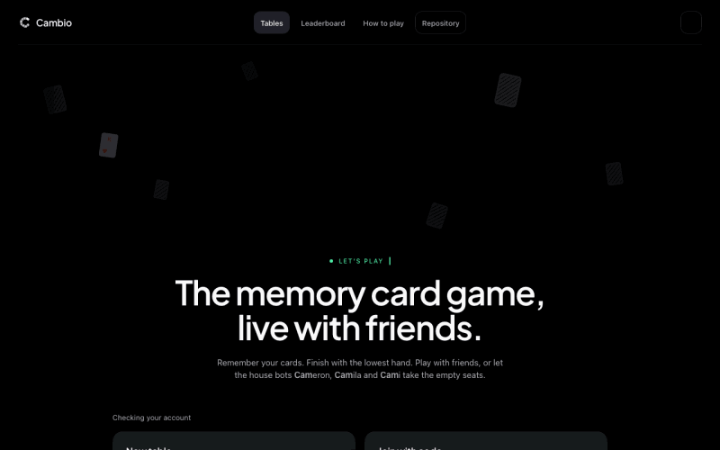
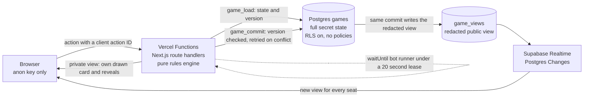

<p align="center"></p>

# Cambio

[](https://github.com/bhnsadhu/cambio/actions/workflows/ci.yml)
[](https://cambio.bhanusadhu.com/leaderboard?scope=all)

A real time multiplayer web app for the card game Cambio, also known as Cabo, where house bots that see only what a human could see fill every empty seat.

**Play it live: [cambio.bhanusadhu.com](https://cambio.bhanusadhu.com)**

## The question

Can bots that only see what a human could see play at three clearly different skill levels, and can their Cambio calls be trusted?

The engine already keeps hidden cards out of each bot's view, and a seeded benchmark already orders easy, medium and hard. Still open: how large each gap is once intervals are attached, which bot abilities actually add strength, and whether the belief behind each Cambio call matches how often those calls win. The hypotheses are written down before any evaluation code, and the results are coming.

## Demo

<!-- TODO: demo gif. Record one short round at a laptop window size: open a table, the ready check, a draw and swap, a stick, a Cambio call, and scoring. Save it as docs/images/demo.gif, then replace this comment and the placeholder line below with:  -->
*Demo recording coming soon.*

## Architecture



Every move is a pure function over the current state. The server loads the state and its version, runs the action through the engine, and commits only if the version is unchanged; a losing commit reloads and runs again, so the rules decide every late arrival. More in [docs/architecture.md](docs/architecture.md).

## Highlights

| Feature | What it does |
| --- | --- |
| **Real time multiplayer** | Every move streams to all four seats over Supabase Realtime. Simultaneous moves are serialized, and the rules decide every late arrival. |
| **Complete game engine** | Turn logic, power cards, anytime sticking, and every way a round can end, in about 1,550 lines of pure TypeScript with no I/O. |
| **Bots that play from memory** | Three house bots fill empty seats and act only on information they have legitimately seen, at three difficulties. |
| **Persistent accounts** | Wins, rank and streak across every table, with friends, invites and a light for whoever is playing right now. |
| **Friends and global leaderboards** | Compare lifetime points with accepted friends or all players. Equal points share a rank, and your position stays visible even outside the current page. Guests can browse the global leaderboard. |
| **Serverless architecture** | Runs on serverless functions and one Postgres database, with no dedicated game server. |
| **Engine and browser regression suites** | Seeded bot versus bot tables played to the score, checking that every move is legal, no card is created or lost, and each difficulty beats the one below it. A Playwright suite covers the whole account lifecycle against an isolated database. |

## Tech Stack

| Component | Technology |
| --- | --- |
| Framework | Next.js 16 with the App Router |
| UI | React 19 |
| Language | TypeScript |
| Styling | Tailwind CSS 4 |
| Database | Supabase Postgres |
| Real time sync | Supabase Realtime |
| Database security | Row Level Security and `SECURITY DEFINER` RPCs |
| Hosting and compute | Vercel Functions, with `waitUntil` running bot turns after the response is sent |
| Animation | Web Animations API, with no animation library |
| Testing | Vitest, Playwright, and isolated Postgres lifecycle checks |
| Continuous integration | GitHub Actions, with no real secrets |
| Typography | Plus Jakarta Sans |

## Measured and not yet measured

**Measured**

* Bot strength on fixed seeds: in 192 complete bot versus bot rounds with equal reaction speeds and reversed seatings, hard earned 64.5 win shares to medium's 31.5, and medium earned 82.5 to easy's 13.5. Every round finished with only legal moves and every card accounted for after every action. Rerun it with `BOT_BENCHMARK=1 npm test -- src/lib/game/bot-strength.test.ts --silent=false`; details in [docs/bots.md](docs/bots.md).
* Hidden information: tests permute every unseen card, reverse the deck, and throw on any attempted read of a card a bot has not seen, and the bots' plans must not change.

**Not yet measured**

* Intervals around those bot gaps, which bot abilities matter, and how often Cambio calls win compared with the belief behind them. This is [the question](#the-question) above.
* Any human versus bot play.
* Load, latency, or behavior under real traffic beyond the concurrency races the tests stage.
* Phone play. The table is built and tested for laptop and desktop windows.

## Run It Locally

You need a Supabase project.

### 1. Set up the database

Apply the migrations, in order:

```text
supabase/migrations/0001_cambio_schema.sql
supabase/migrations/0002_social.sql
supabase/migrations/0003_presence_invites.sql
supabase/migrations/0004_accounts.sql
supabase/migrations/0005_usernames.sql
supabase/migrations/0006_table_join_requests.sql
supabase/migrations/0007_social_resends.sql
supabase/migrations/0008_room_do_not_disturb.sql
supabase/migrations/0009_leaderboard.sql
supabase/migrations/0010_browser_presence.sql
supabase/migrations/0011_profile_avatars.sql
supabase/migrations/0012_avatar_skin_tones.sql
supabase/migrations/0013_live_presence.sql
```

Then store a server secret:

```sql
insert into private.server_config(key, value)
values ('server_secret', '<hex>');
```

Replace `<hex>` with your server secret.

### 2. Install dependencies and configure the environment

```bash
npm install
cp .env.example .env.local
```

Fill in `.env.local` with your Supabase URL, anon key, and server secret.

| Setting | Purpose |
| --- | --- |
| Supabase URL | Connects the app to your Supabase project |
| Supabase anon key | Allows browser access to permitted game views |
| `CAMBIO_SERVER_SECRET` | Must match the `server_secret` value stored in `private.server_config` |

### 3. Start the app

```bash
npm run dev
```

### 4. Run the tests

```bash
npm run typecheck
npm run lint
npm test
```

For the complete account lifecycle, start Docker and install the test browser once:

```bash
npx playwright install chromium
npm run test:accounts
```

This command creates isolated Postgres and PostgREST containers, applies every migration, runs the SQL account tests, starts a local app using dummy credentials, and runs the browser suite. It removes the test containers afterward. Stop any existing Next development server first so the test app can use the development build directory.

The browser suite covers registration, duplicate usernames, display name changes at active tables, username changes, wrong and correct passwords, session revocation, logout, a failed logout request, delayed responses after logout, multiple tabs, legacy profile upgrades, restored stats and friends after clearing storage, seat recovery, permanent deletion, request origin checks, and the account and login pages in a 390 pixel wide window without sideways scrolling. The same run also covers gameplay, bots, presence, notifications, seat management, and the table at laptop sizes from 1024 by 768 to 1440 by 900. These tests never use the live Supabase database.

Continuous integration runs all of the above on every push and pull request; see [.github/workflows/ci.yml](.github/workflows/ci.yml).

### 5. Regenerate the bot evaluation

```bash
npm run results
```

This deletes and rewrites every file in `results/` and the three charts in `docs/images/`, then prints how long it took. It first replays the original seeded benchmark and stops if that no longer reproduces, then plays 6,800 seeded bot rounds across all CPU cores. On an 8 core Apple M3 it printed 107.7 and 129.5 seconds on two runs. The output is deterministic: runs with 3 and 7 workers wrote byte identical files. It needs Node 24 and no extra packages, since Node runs the TypeScript directly.

## Deeper docs

| Doc | What is in it |
| --- | --- |
| [How to play](docs/how-to-play.md) | Quick start, the steps of a round, scoring, and additional rulings |
| [The game engine](docs/engine.md) | Every rule system the engine enforces, and the power cards |
| [Bot AI](docs/bots.md) | What bots may know, the three levels, the Cambio gate, and the benchmark |
| [Architecture](docs/architecture.md) | Real time state sync, hidden information boundaries, and the project layout |
| [Profiles and friends](docs/accounts.md) | Accounts, guests, presence, friends, invites, and the permanent record |
| [Front end](docs/front-end.md) | Card motion and the notification scale |
| [Visual reference](docs/visual-reference.md) | Visual sources and avatar artwork |
| [Avatar skin tones](docs/avatar-skin-tones.md) | How the tone sheets were made and rendered |
