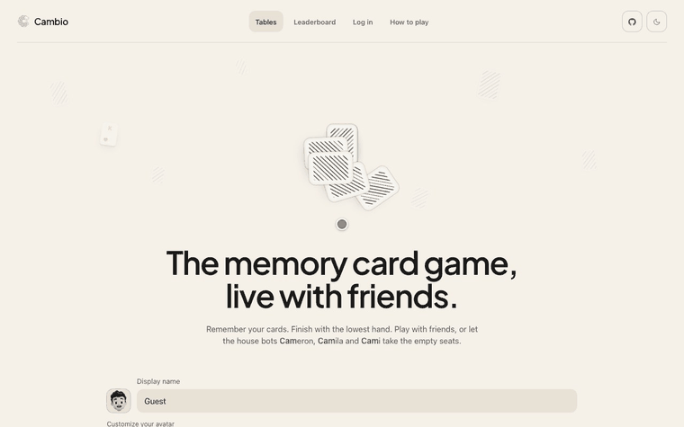
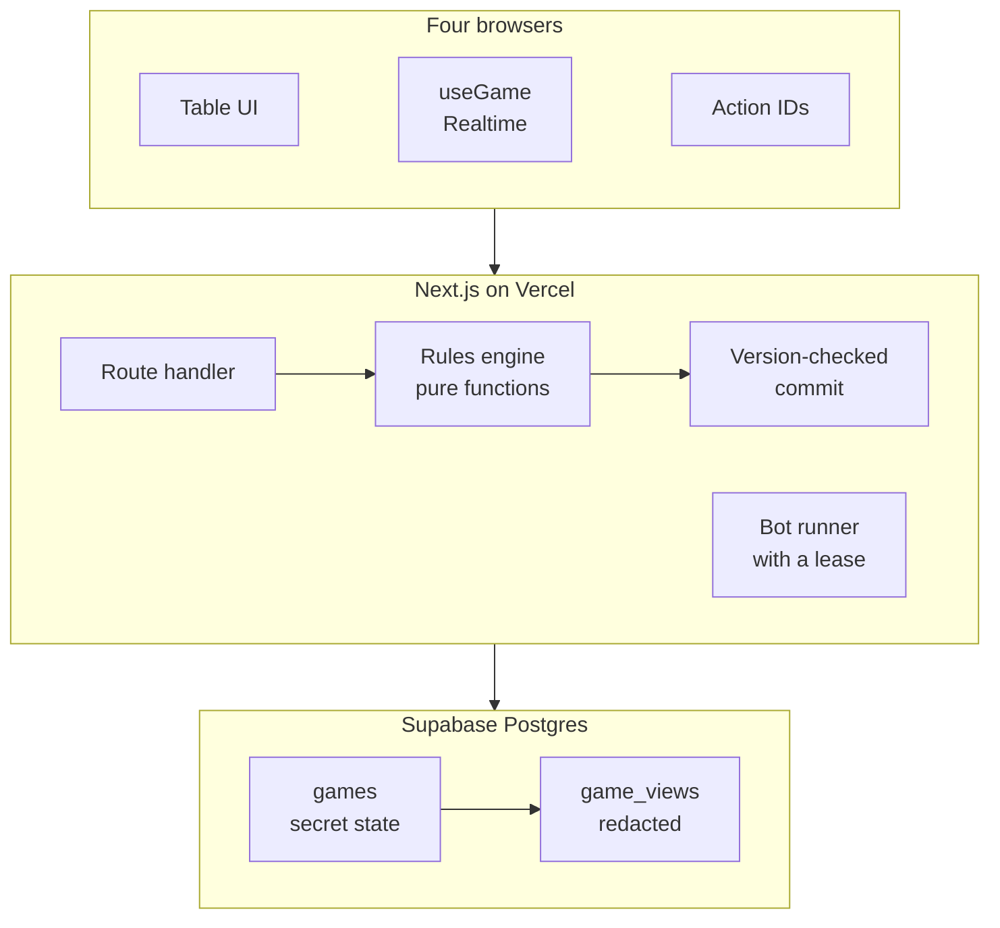
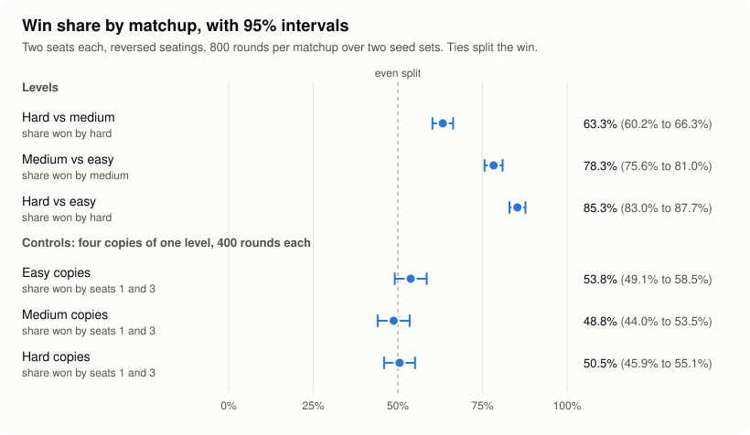
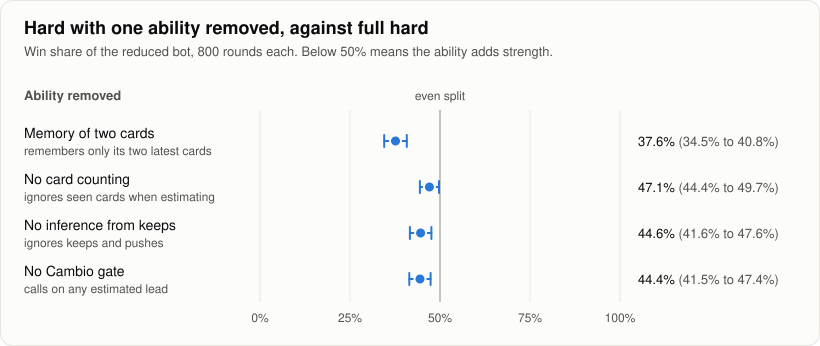

<p align="center">
  <picture>
    <source media="(prefers-color-scheme: dark)" srcset="docs/logo/screens/logo-180-dark.png">
    
  </picture>
</p>

# Cambio

**A real-time, four-seat memory card game in the browser, with house bots at three skill levels whose strength was measured, not assumed.** Share a five-character code and play.

**[Play it → cambio.bhanusadhu.com](https://cambio.bhanusadhu.com)** · free, play as a guest or make an account



## The problem

Cambio (also called Cabo) is a game of remembering four face-down cards you may look at only twice, then swapping, matching and bluffing your way to the lowest hand. It is played in person with a deck of cards. Online versions either hand a lone player a trivial bot or need a custom game server, and the hard part of both is the same: **every player must see a shared table in real time while every other player's cards stay hidden.**

Cambio's goal is a table that stays in sync across four browsers, never leaks a hidden card, and has opponents worth playing.

## How it works

1. **Open a table.** Enter a display name, press **Open a table** and share the code. Up to four seats, and three house bots (Cameron, Camila and Cami at easy, medium and hard) fill any empty ones.
2. **Ready check, then peek.** Cards are dealt face down and everyone sees their own bottom two for five seconds, all at once.
3. **Play turns.** Draw, then either use the card's power or swap it into any hand at the table. Anyone may "stick" a card they think matches the pile, at any moment.
4. **Call Cambio.** Call at the start of your turn instead of drawing and everyone else gets one more turn.
5. **Score.** Hands are revealed, the lowest total wins and leads the next round. Accounts keep a record, friends and a leaderboard.

The full rules are in [docs/how-to-play.md](docs/how-to-play.md).

## Product decisions

| Decision | Trade-off |
| --- | --- |
| **Guests play at once, accounts are optional** | No sign-up wall, so a guest's stats are table-only. An account adds a username, avatar, friends, presence and the record books. |
| **Bots fill empty seats** | A table never waits for four people. The cost is a lot of work to make the bots fair and fun, which became half the project. |
| **Sticking is open to every seat at every moment** | Early versions refused a stick on your own turn. Allowing it made the game faster and more chaotic, and made the rules and the UI harder to get right. |
| **Pausing needs every seat to agree** | One player cannot freeze a table, and bots agree instantly. Pausing is slower than a host button. |
| **Three bot levels with different memory, not different luck** | Easy forgets all but its last two cards. Hard remembers every legitimately seen card. Each level is a real play style, and no level cheats. |
| **Keep better-calibrated bots off** | Learned bot policies beat the hand-written ones but failed a safety test, so they ship disabled. See the results below. |

## Architecture



Every action is a pure function from the secret game state to a new state. The server loads the state with its version, applies the action through the engine and commits with a compare-and-swap inside Postgres, retrying against the winner if two players act in the same few milliseconds. Browsers receive only redacted `game_views` over Supabase Realtime and can read nothing else. See [docs/architecture.md](docs/architecture.md).

## Hard problems

**Hidden information in a shared real-time game.** The full state, including every card, lives in one JSONB row behind Row Level Security with no policies, reachable only through `SECURITY DEFINER` functions that need a shared secret. Browsers hold only an anon key and can read only the redacted view for their seat. Reshuffled cards get fresh IDs, so a card seen in the discard pile cannot be traced back into the deck. Fairness tests change hidden faces, reverse the deck and replace opponents' private knowledge, and fail if a bot's moves change. See [src/lib/game](src/lib/game).

**Two players, one millisecond.** Version-checked commits make one action lose, reload and re-run against the winner's state, so the rules decide the outcome and nothing is dropped or applied twice. Client-generated action IDs make a retried request idempotent, and clients discard any view older than the one they hold.

**Bots that only know what a human could know.** A bot's strategy receives an observation of its own seat's memory, its own draws, private power reveals and public movements, never the deck order or another seat's cards. The test suite throws on any attempted secret read. The three levels differ in memory and how often they use the full strategy (50%, 75% and 100% of tactical opportunities), measured at 49.9%, 75.1% and 100% in an instrumented audit. See [docs/bots.md](docs/bots.md).

**Proving the bots, not asserting it.** The evaluation was committed with its hypotheses before any code ran. Over 800 rounds per matchup, hard won **63.3%** of the win share against medium (95% interval 60.2% to 66.3%) and medium **78.3%** against easy (75.6% to 81.0%). Removing memory dropped a hard bot to **37.6%** against full hard. And one hypothesis was refuted: the bots' Cambio calls, made at an average 87.0% belief of winning, **won only 54.0%**.



## Results

- **384 unit and integration tests in 36 files** (Vitest). The rules engine has no I/O, so rules are tested as pure functions, along with hidden-information projections, bot fairness and Postgres functions.
- **109 Playwright tests in 29 files** covering table flow, seat and host management, presence, notifications, accounts, and the leaderboard.
- **Bot ladder, 800 rounds per matchup on fresh seeds:** hard beats medium 63.0%, medium beats easy 80.2%, easy beats a minimal beginner reference 55.2% and medium beats it 73.7%. Hard reaches 78.4% against the beginner, **missing its 85% target**.
- **Learned bots:** a learned call model cut calibration error (ECE) from **0.310 to 0.086**, and learned actions helped medium (54.7%) and hard (58.8%) against their hand-written selves but not easy. They stay off: with learned calls, a bot called Cambio on a hand it knew was losing, and with learned actions one existing behavior test failed.
- **Reproducible:** `npm run results` regenerates every table and chart from scratch, byte-identical across runs.



**Not measured:** play against real people, whether the bots feel fun, real reaction speed, and behavior under real traffic. The reaction-speed audit was void because of a bug in its own instrumentation.

## How it was built

- **Rules and sync first.** A pure rules engine, the Supabase schema and Realtime views, and a table UI that played a full round.
- **Social layer.** Guests and accounts, avatars, friends, presence, a leaderboard and record books.
- **Rules by playing.** Ready checks, anytime sticking, unanimous pausing and host succession each came from a game that felt wrong, and each is recorded with the tests that pin it in [docs/decisions.md](docs/decisions.md).
- **Bots that cannot cheat.** Every strategy was restricted to its own seat's observation, with tests that fail on any secret read.
- **A pre-registered evaluation.** Hypotheses were written down before the harness, and one came back refuted.
- **Learned policies, shelved.** Models were trained and tuned on separate seeds, tested once, and kept off because of the safety failure.

## Tech stack

| Layer | Technology |
| --- | --- |
| Frontend | Next.js 16, React 19, TypeScript, Tailwind 4 |
| Backend | Next.js route handlers, Vercel `waitUntil` for bot turns, salted scrypt sessions |
| Data | Supabase Postgres with Row Level Security, `SECURITY DEFINER` functions and Realtime |
| Bot learning | Python (scikit-learn, NumPy) for fitting, a plain TypeScript forward pass at runtime |
| Testing | Vitest, Playwright |
| Hosting | Vercel and Supabase |

## Run it locally

```bash
npm install
npm run dev              # needs a Supabase project and the variables below
npm run typecheck && npm run lint && npm test
npm run results          # regenerate the bot evaluation tables and charts
npm run ml:evaluate      # learned-policy evaluation on the test seeds
```

Environment variables are `NEXT_PUBLIC_SUPABASE_URL`, `NEXT_PUBLIC_SUPABASE_ANON_KEY` and `CAMBIO_SERVER_SECRET`, which must equal the server secret stored in Supabase. Pushing to `main` deploys to Vercel.

## Project structure

```text
src/lib/game/     pure rules engine, bot strategies, redacted views, bot harness
src/lib/server/   load, apply and commit with a version check, bot runner
src/lib/client/   useGame hook, Realtime subscription, card flights
src/components/   table UI, profiles, friends panel
supabase/         schema, RPCs and database tests
ml/               training code for the learned policies
scripts/          evaluation and ablation scripts
results/          raw and summary evaluation data
docs/             architecture, bots, rules, decisions, experiments
e2e/              Playwright specs
```

## What's next

**Known limits**

- No evidence from real players on whether the bots feel right or fun.
- Hard misses its own target against a beginner reference, and learned calls need a guard before they are safe.
- The bots' Cambio calls are overconfident: they believe 87.0% and win 54.0%.
- Reaction speed is set by constants, not measured.

**Next:** guard the learned call model with the gate's safety rules, play-test the bots with real people, and time bot decisions under live traffic.

[Architecture](docs/architecture.md) · [Bots](docs/bots.md) · [Bot evaluation](docs/experiments/bot-evaluation.md) · [Decisions](docs/decisions.md) · [Rules](docs/how-to-play.md) · [Accounts](docs/accounts.md)
