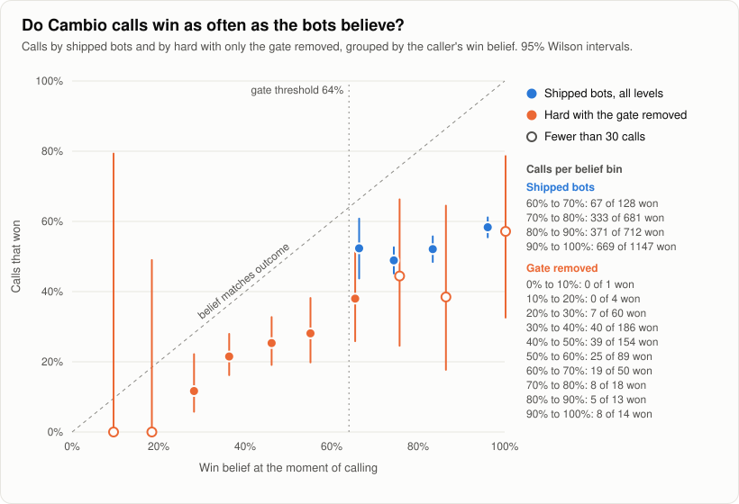
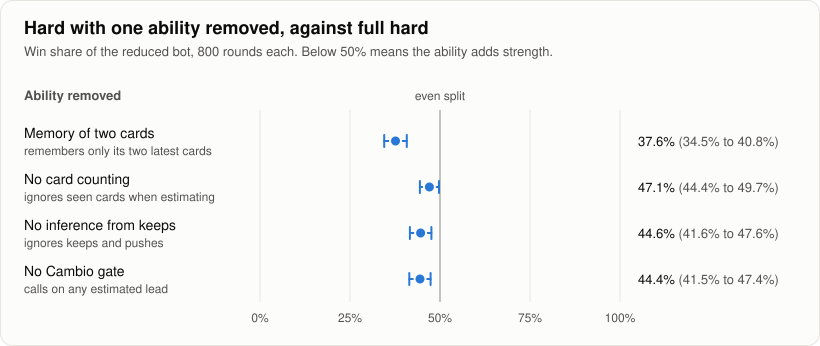

# Bot evaluation

Back to the [README](../../README.md). The bots themselves are described in [docs/bots.md](../bots.md).

## The question

Can bots that only see what a human could see play at three clearly different skill levels, and can their Cambio calls be trusted?

This document was committed before any evaluation code. The hypotheses and the conditions that would refute them come first; the results will be added below them without changing the hypotheses.

## Setup

**Engine and bots.** Every round is played by the production rules engine (`src/lib/game/engine.ts`) and the production bot strategy (`src/lib/game/bots.ts`). Nothing is forked. Bots see only what their seat could see, which existing tests already enforce.

**Harness.** The seeded bot versus bot harness from `src/lib/game/bot-strength.test.ts`: one complete round per seed with four bot seats, equal reaction speeds for every level, deterministic randomness per seed, and checks after every action that the move was legal and that all 54 cards are still accounted for with no duplicates. A round that does not finish counts as a failure, not as a result.

**Matchups.** Two sides share a table, two seats each, alternating around it (A B A B). Each seed is played twice with the seating reversed (B A B A), so each side holds each position once per seed.

**Seeds.** Two independent seed sets of 200 seeds each, so every matchup is played over 800 rounds (2 sets, 200 seeds, 2 seatings). The sets are 1 to 200 and 10001 to 10200.

**Ablations.** A strategy options object lets one ability be removed from a bot. Its defaults must equal current behavior exactly, which is checked before anything else by reproducing the existing benchmark: hard 64.5 win shares to medium's 31.5, and medium 82.5 to easy's 13.5, on the existing seeds. If that does not reproduce, the evaluation stops. Each ablation removes one ability from a hard bot and plays it against full hard:

* **Memory:** keeps only its two most recently observed cards, the same length as easy.
* **Card counting:** always assumes an unseen card is drawn from the full deck, ignoring the discards and remembered cards it has seen.
* **Inference from public keeps:** gives no weight to an opponent keeping or pushing a drawn card.
* **Cambio gate:** drops the belief thresholds and calls whenever it estimates it leads, after the same minimum number of turns.

**Controls.** Four copies of the same level, with seats 1 and 3 counted as one side and seats 2 and 4 as the other, over both seed sets (400 rounds per level). A seat order check compares each matchup's result when side A sits first with its result when side A sits second.

**Measures.**

* Win share: each round's win is split equally among tied winners, so the two sides' shares add up to one per round. An even split is 0.5.
* Mean final hand score per seat.
* Every actual Cambio call, logged with the caller's estimated win belief at the moment of calling and whether the caller finished among the round's winners. Beliefs are grouped into bins, and each bin reports its count and observed win rate. A bin with fewer than 30 calls is reported as too small to judge.

**Intervals.** For each seed, a side's win share is averaged over its two seatings. The 95% interval is the mean across seeds plus or minus the t critical value times the standard deviation across seeds divided by the square root of the number of seeds. The same method gives intervals for mean scores and for the seat order difference. Observed win rates in calibration bins use the Wilson score interval.

**Outputs.** Raw and summary results as CSV and JSON under `results/`, charts under `docs/images/`, all regenerated from scratch by `npm run results`.

## Hypotheses

**H1. Hard beats medium, and medium beats easy, in win share.**
Refuted if the 95% interval for either matchup includes an even split.

**H2. The shared Cambio gate works as documented.**
Refuted if the win rate of bot calls falls below the belief threshold the gate requires (64%).

**H3. Each bot ability adds measurable strength: memory, card counting, inference from public keeps, and the call gate.**
Refuted for an ability if removing it does not change win share outside its 95% interval.

**H4. The harness is fair.**
Refuted if a bot playing copies of itself deviates from an even split outside its interval, or if results change with seat order.

## Results

Everything below comes from `npm run results` (introduced in 44fda52, with the H2 grouping corrected in e0e09d8). One run plays 6,800 rounds and logs 3,784 actual Cambio calls. Raw data is in `results/rounds.csv` and `results/calls.csv`; summaries are in `results/matchups.csv`, `results/calibration.csv` and `results/summary.json`. The output is byte identical across runs and worker counts.

**Defaults check first.** With the options object in place and every option at its default, the original benchmark reproduces exactly, so the evaluation went ahead:

| Matchup, seeds 1 to 24 and 101 to 124 | Win shares | Mean final hand |
| --- | --- | --- |
| Hard vs medium | 64.5 to 31.5 | 5.06 vs 7.40 |
| Medium vs easy | 82.5 to 13.5 | 6.05 vs 12.43 |

| Hypothesis | Verdict | Key numbers |
| --- | --- | --- |
| H1, levels ordered | **Supported** | Hard won 63.3% against medium (60.2% to 66.3%); medium won 78.3% against easy (75.6% to 81.0%) |
| H2, calls trustworthy | **Refuted** | Shipped bots' calls won 54.0% (52.1% to 55.9%), below the 64% the gate requires, at an average belief of 87.0% |
| H3, each ability adds strength | **Supported for all four** | Removing memory, counting, inference or the gate each left hard below an even split |
| H4, harness fair | **Supported** | Every copies control and every seat order difference stayed within its interval |

### H1: the three levels are clearly ordered. Supported.

| Matchup | Share won by the first side | Seed set A | Seed set B | Mean final hand |
| --- | --- | --- | --- | --- |
| Hard vs medium | 63.3% (60.2% to 66.3%) | 62.1% (57.9% to 66.4%) | 64.4% (60.0% to 68.9%) | 5.64 vs 7.82 |
| Medium vs easy | 78.3% (75.6% to 81.0%) | 80.8% (77.2% to 84.3%) | 75.8% (71.8% to 79.8%) | 6.65 vs 12.58 |
| Hard vs easy | 85.3% (83.0% to 87.7%) | 85.6% (82.3% to 88.9%) | 85.1% (81.7% to 88.5%) | 5.23 vs 13.25 |

Each matchup is 800 rounds over 400 seeds. Neither interval for H1 comes near an even split, and each seed set agrees on its own.

### H2: the Cambio gate. Refuted.

Every call the shipped bots made passed the gate, as the tests require, so every caller believed it had at least a 64% chance of winning. Those calls won far less often than that: 1,440 of 2,668, or 54.0% (Wilson interval 52.1% to 55.9%), while the average belief at the moment of calling was 87.0%. A tie for the lowest hand counts as a win here, as it does in the belief; 254 of the 1,440 wins were ties.

| Belief at the call | Calls | Won | Observed win rate | 95% interval |
| --- | --- | --- | --- | --- |
| 64% to 70% | 128 | 67 | 52.3% | 43.7% to 60.8% |
| 70% to 80% | 681 | 333 | 48.9% | 45.2% to 52.6% |
| 80% to 90% | 712 | 371 | 52.1% | 48.4% to 55.8% |
| 90% to 100% | 1,147 | 669 | 58.3% | 55.4% to 61.1% |

Every bin has at least 128 calls, and every bin's observed rate sits at least 15 points below its average belief: 67.6% believed against 52.3% observed in the lowest bin, and 97.3% against 58.3% in the highest.

| Level | Calls | Won | Observed win rate | 95% interval | Average belief |
| --- | --- | --- | --- | --- | --- |
| Easy | 260 | 162 | 62.3% | 56.3% to 68.0% | 85.7% |
| Medium | 822 | 462 | 56.2% | 52.8% to 59.6% | 86.4% |
| Hard | 1,586 | 816 | 51.5% | 49.0% to 53.9% | 87.5% |

Easy's interval alone still reaches 64%; medium's and hard's do not. Hard, the level with the best information, makes the least accurate calls. It also makes the most, partly because full hard sits in seven of the ten matchups.

Where the belief misses, measured from the same calls: the caller's final hand ended on average 3.29 points worse than its own estimate (median 2.16), even though it knew all but 0.25 of its own cards on average when it called. The best opponent ended on average 2.74 points better than the rollout's estimate for the strongest opponent (median 2.73), and better than that estimate in 77.7% of calls. Both errors push toward losing. The rollout gives each opponent one final draw and its best improving replacement; it does not model sticks, pushed cards, blind swaps or other powers during the final turns. Whether those account for the gap was not measured.

With the gate removed, hard called whenever it estimated a lead: 589 calls at an average belief of 45.8%, of which 151 won (25.6%, 22.3% to 29.3%). In every gate removed bin with at least 30 calls, the observed rate is again below the belief. The bins below 20% and above 70% hold fewer than 30 calls each and are too small to judge.

### H3: each ability adds strength. Supported for all four.

Each row is a hard bot with one ability removed, against full hard bots, over 800 rounds.

| Ability removed | Reduced bot's win share | Seed set A | Seed set B | Mean final hand, reduced vs full |
| --- | --- | --- | --- | --- |
| Memory: keeps only its two latest cards | 37.6% (34.5% to 40.8%) | 35.8% (31.4% to 40.2%) | 39.5% (35.0% to 44.0%) | 7.27 vs 5.30 |
| Card counting | 47.1% (44.4% to 49.7%) | 47.2% (43.4% to 51.1%) | 46.9% (43.2% to 50.6%) | 5.83 vs 5.75 |
| Inference from public keeps | 44.6% (41.6% to 47.6%) | 41.7% (37.6% to 45.7%) | 47.6% (43.2% to 52.0%) | 6.30 vs 5.58 |
| Cambio gate | 44.4% (41.5% to 47.4%) | 44.0% (40.1% to 47.9%) | 44.9% (40.4% to 49.4%) | 9.85 vs 9.26 |

Memory matters most. Card counting is the smallest effect and passes only narrowly: its pooled interval tops out at 49.7%, and each seed set on its own includes an even split. Removing the gate costs strength even though the gate's beliefs are badly overconfident (H2): in that matchup a Cambio call ended 678 of the 800 rounds, 589 of them by the gateless bots, and those calls won about one time in four. So the gate works as a filter even though its numbers are not probabilities.

### H4: the harness is fair. Supported.

Four copies of the same level, seats 1 and 3 against seats 2 and 4, 400 rounds each:

| Level | Share won by seats 1 and 3 |
| --- | --- |
| Easy | 53.8% (49.1% to 58.5%) |
| Medium | 48.8% (44.0% to 53.5%) |
| Hard | 50.5% (45.9% to 55.1%) |

Seat order, for each reversed matchup: the first side's share when it sat in seats 1 and 3, when it sat in seats 2 and 4, and the 95% interval of the difference per seed. Every interval spans zero.

| Matchup | Seats 1 and 3 | Seats 2 and 4 | Difference, 95% interval |
| --- | --- | --- | --- |
| Hard vs medium | 63.0% | 63.6% | 7.2 points lower to 6.0 points higher |
| Medium vs easy | 79.6% | 77.0% | 3.0 points lower to 8.2 points higher |
| Hard vs easy | 86.6% | 84.1% | 2.1 points lower to 7.1 points higher |
| Memory removed vs hard | 38.8% | 36.5% | 4.1 points lower to 8.9 points higher |
| Counting removed vs hard | 46.4% | 47.7% | 8.6 points lower to 6.0 points higher |
| Inference removed vs hard | 43.2% | 46.0% | 9.9 points lower to 4.2 points higher |
| Gate removed vs hard | 43.7% | 45.2% | 8.8 points lower to 5.7 points higher |

Easy copies come closest to the edge (the interval's low end is 49.1%), so a small seat effect at that level cannot be ruled out at this sample size.

## What did not work or was not measured

* **No human versus bot data.** Every number here is bots playing bots. Whether the gaps between levels hold against people, or how the levels feel to play, is unknown.
* **No load or latency testing.** The evaluation calls the engine directly. Nothing here measures the realtime layer, the Vercel functions or Postgres under many simultaneous tables.
* **Belief estimates are decision estimates, not calibrated promises.** H2 now puts a number on it: calls believed to win 64% to 100% of the time won about half the time. The gate is a useful filter (H3), but its percentages should not be read as probabilities. Calibrating them, for example by modeling final turn sticks and attacks, was not attempted.
* **The best informed level makes the worst calls.** Hard's calls won 51.5%, against 62.3% for easy. Why was not measured.
* **Rounds, not games.** Each seed plays one round. Full games, where the winner leads the next round, were not simulated.
* **Equal reaction speeds.** Every level gets the same reaction time here, so hard's faster sticks in the live game are not part of these numbers, and races between sticks are not tested.
* **One memory length.** Only a two card memory was removed and tested. Medium's actual rule (its own cards plus six others) and other lengths were not tested separately, and every ablation was tested only as hard against hard.
* **Card counting's effect is small.** It clears the H3 bar only when both seed sets are pooled.

## Learned policies: H5 to H9

This section was committed before any model, training or data logging code. The hypotheses and thresholds below will not be edited; if a mistake is found, a dated correction note goes underneath them. The results will be added in their own section below.

### The question

Can models trained on simulated play make each level play more accurately, with Cambio calls whose probabilities can be trusted, while each level still knows only what it knows today and the three levels stay distinct?

### Setup

**Decision points.** Every choice a bot makes: at the start of its turn, call Cambio or draw (a draw always comes from the deck; this ruleset has no draw from the discard); with a drawn card, place it on the pile or swap it into any slot at the table, its own or an opponent's; each power (look at one of its own cards, look at an opponent's card, blind swap two cards, look at two cards with a king), including whether to skip it, and after a king look whether to swap; whether to stick a remembered matching card and which one; and which card to give after sticking an opponent's card.

**What a level may know.** A model for a level gets features built only from that seat's observation (`observeBot`): its own remembered faces, capped by its memory length (easy two cards, medium its own cards plus six others, hard everything it has seen), the face up pile, public positions, and the public keeps and pushes, through the same card counting and inference its frozen strategy already uses. Nothing else: no deck order, no unseen faces, no other seat's memory. Each level gets its own models, trained only on its own decision points. Easy and medium keep their effort rolls (the full strategy on 50% and 75% of opportunities, with the same lapses otherwise); a learned action policy only replaces what the level does when it is focused.

**Frozen versions.** Today's decisions stay in the code as named options, call policy `gate_v1` and action policy `rules_v1`, chosen through the seat's strategy object the way the ablation options are. Learned options are added next to them as call policy `model_v1` and action policy `model_v1`. Live tables keep the frozen options until this evaluation supports a switch.

**Data.** Seeded rounds of frozen bots at mixed tables. At each sampled decision point, each candidate action is valued by copying the true state, taking the action, shuffling the undealt deck (which no seat has seen), and playing the rest of the round with the frozen bots, several times, with the same shuffles for every candidate at that point. The value of an action is the deciding seat's mean win share (a tie splits the win) and mean final margin (the best other hand minus its own). Features come only from the seat's knowledge; labels come from true outcomes, so across many examples a model learns the expected value given what the seat knows. The number of rollouts is recorded with the data.

**Seed sets.** Training 100001 onward, validation 200001 to 200400, test 300001 to 300200 and 310001 to 310200. None overlaps the seeds the existing evaluation, the benchmark or the tests use (1 to 200, 10001 to 10200, 101 to 124, and the small fixture seeds). Every model choice, threshold and softening is made on validation seeds only. The test seeds are used once, for the run described below, and for nothing else.

**Models.** A call model per level predicts whether calling now wins (a tie counts as a win, as in H2). An action model per level predicts each candidate action's value. Both are exported as small JSON files and run by a plain TypeScript forward pass with no new runtime dependency. A level using `model_v1` for calls calls when the model's probability clears that level's threshold, after the same minimum of one full lap of turns.

**Configurations.** C uses the learned call policy with frozen actions. A uses the learned action policy with frozen calls. CA uses both. A frozen seat uses `gate_v1` and `rules_v1`.

**Test run.** The same harness, side layout, reversed seatings, intervals and sample size as H1 to H4: each matchup is played on both test sets (400 seeds) in both seatings, 800 rounds. For each configuration X: each learned level against its frozen self (easy X vs easy, medium X vs medium, hard X vs hard); learned levels against each other (hard X vs medium X, medium X vs easy X); and each learned level against the frozen level above it (easy X vs medium, medium X vs hard). Frozen hard vs medium and medium vs easy are also played on the test seeds for reference. Win share intervals use the same t interval across seeds as H1 to H4. The existing results files are left unchanged; new results go in their own files.

**Calibration error.** Expected calibration error (ECE): calls grouped into ten equal width probability bins, the absolute gap between each bin's average stated probability and its observed win rate, weighted by the bin's share of calls. On the existing evaluation, the gate's ECE over the shipped bots' 2,668 calls is 0.330.

### Hypotheses

**H5. The learned call model's probabilities are better calibrated than the gate's beliefs.**
Measured on the test run: the ECE of the model's probability at every actual call by a seat using the learned call policy (configurations C and CA), against the ECE of the gate's win belief at every actual call by a frozen seat in the same matchups.
Refuted if the model's ECE is above 0.10, or if the 95% bootstrap interval of the gate's ECE minus the model's ECE (resampling test seeds, 2,000 resamples with a fixed seed) includes zero or falls below it.

**H6. Each level's learned action policy beats its own frozen version.**
Measured on the test run in configuration A: easy A vs easy, medium A vs medium, hard A vs hard.
Refuted for a level if the 95% interval of the learned side's win share includes 50% or lies below it.

**H7. The level ordering survives with the learned policies.**
Measured on the test run for each configuration X: hard X vs medium X and medium X vs easy X.
Refuted for a configuration if either matchup's 95% interval for the stronger level includes 50% or lies below it.

**H8. No learned policy gains from information its level should not have.**
Checked by the hidden information tests, for every level and for configurations C, A and CA: an attempted read of an unobserved card, the deck, or another seat's memory throws; permuting every card the level cannot know, reversing the deck, and giving other seats false private knowledge must leave the observation, the model features, the call assessment and the planned moves unchanged; each level's memory limit is unchanged with learned options in seeded rounds; and every level's models take the same feature list, built only from that level's observation.
Refuted if any of these tests fails, or if a learned component cannot be covered by them.

**H9. Levels keep their identity.**
Measured on the test run for each configuration X: easy X vs frozen medium, and medium X vs frozen hard.
Refuted for a configuration if the learned lower level's 95% interval includes 50% or lies above it.

**Thresholds.** The intervals in H1 to H4 have half widths of about 3 points at 800 rounds (hard vs medium, 60.2% to 66.3%), and the test run uses the same sample size, so an effect smaller than about 3 points will not be detected and is not claimed. The H5 ceiling of 0.10 is less than a third of the gate's 0.330, and wider than the sampling noise expected from several hundred calls.

**What goes live.** The learned call policy goes live only if H5, H7, H8 and H9 are supported for configuration C, and for CA as well if the learned action policy also goes live. The learned action policy goes live only if H6, H7, H8 and H9 are supported for configuration A, and for CA as well if the learned call policy also goes live. Each switch is one constant. A component that is not supported stays on its frozen version.

### What will not be measured

* **Human play.** No human versus bot games, and no claim that the learned bots feel right, fair or fun to people. Every number is bots playing bots.
* **Full games.** Single rounds, as in H1 to H4, at equal reaction speeds.
* **Live performance.** Nothing measures the model's speed inside the Vercel functions or under real traffic, beyond a unit test that the forward pass runs.
* **Other model families or data sizes.** Only the models named in the training write up are compared, at laptop scale, and the rollout values are estimates from a limited number of rollouts.
* **Opponents other than these bots.** The models learn values against the frozen bots; how they fare against other strategies, including human habits such as bluffing keeps, is unknown.
* **Action accuracy on the test seeds.** Agreement with the best rollout action is reported on validation seeds only; the test seeds are used for the matchups and calls above.
