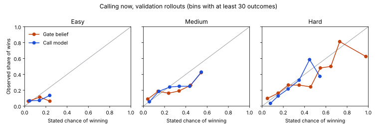

# Learned bot policies

Training code and data for the learned call and action policies evaluated as H5 to H9 in [the bot evaluation](../docs/experiments/bot-evaluation.md). Back to the [README](../README.md).

Everything here runs on a laptop with no paid service. The TypeScript side produces the data and runs the exported models; the Python side only fits and exports them.

## Data

`npm run ml:data -- --split train --seeds 200` plays seeded rounds of frozen bots (call policy `gate_v1`, action policy `rules_v1`) and values sampled decision points by rollouts. It writes `ml/data/<split>.jsonl`, one JSON line per decision point, and `ml/data/<split>.manifest.json` with the seeds, the commit, the rollout counts, the feature names, the row counts and a SHA-256 of the data. `ml/data/` is gitignored; [ml/data-sample/](data-sample) holds the first lines of the training data so the schema can be read without running anything.

Only two splits can be collected: training seeds from 100001 and validation seeds from 200001 to 200400. The test seeds (300001 to 300200 and 310001 to 310200) are refused; they are used once, for the evaluation run.

Each round seats every level once, plus one level twice, in a seeded order. Every seat's decisions are found as the frozen round is played, and a seeded share of each kind is valued (all powers and gives, half of the sticks, 35% of the call decisions and 30% of the drawn card decisions).

**Labels.** For each candidate action the true state is copied, the action is taken, the undealt deck (which no seat has seen) is shuffled, and the frozen bots play the rest of the round. Every candidate at a point gets the same shuffles and the same bot randomness, so their values differ only by the action. Each rollout records the deciding seat's win share (1, or 1 split among tied winners, or 0) and its margin (the best other final hand minus its own; positive is good). Action candidates get 4 rollouts each. A call decision gets 8 rollouts of calling now and 2 of drawing instead. The gate may refuse a call; the data records what would have happened anyway.

**Features.** Built by `src/lib/game/bot-features.ts` from the deciding seat's observation only, so a level's data never holds more than that level knows. The same code builds the features when a bot plays.

### Schema

A call decision, at the start of a seat's turn once a full lap has been played:

| Field | Meaning |
| --- | --- |
| `type` | `"call"` |
| `seed`, `lineup`, `point`, `seat`, `level`, `turnsTaken` | Where the decision happened: the round's seed, the levels by seat, the decision's index in the round, the seat (0 to 3), its level, and turns completed |
| `features` | One number per name in the manifest's `callFeatures` |
| `gate` | The frozen gate's win belief, near win belief, and whether it would call |
| `call`, `draw` | Rollout outcomes of calling now and of drawing instead: `share` and `margin`, one entry per rollout |

Any other decision:

| Field | Meaning |
| --- | --- |
| `type` | `"action"` |
| `seed` to `turnsTaken` | As above |
| `kind` | `decide`, `peekOwn`, `peekOther`, `blindSwap`, `kingLook`, `kingDecide`, `stick` or `give` |
| `legal` | How many legal choices there were before pruning |
| `candidates` | Up to 6 choices: the passive one (place, skip, leave, or no stick, written as a null action), the frozen rule's choice, then the best by the frozen evaluator's score. Each has `action`, `rule` (whether the frozen rule picks it), `features` (one number per name in `actionFeatures`) and `outcome` (`share` and `margin` per rollout) |

## Training

```bash
python3 -m venv ml/.venv
ml/.venv/bin/pip install -r ml/requirements.txt
cd ml
.venv/bin/python train_call.py
.venv/bin/python train_action.py
```

Each script fits one model per level on the training data, chooses among its candidates on the validation data only, checks that the exported JSON reproduces scikit-learn's own predictions, and writes the chosen models to [src/lib/game/models/](../src/lib/game/models), a fixed sample of inputs and predictions that the TypeScript forward pass must match, and a validation report in [ml/reports/](reports). Random seeds are fixed, so the same data gives the same models. Each model records the SHA-256 of the training data it came from.

The models in the repository were trained on the data below, both collected at commit 18edbb0 with 4 rollouts per action candidate and 8 per call (2 for drawing instead):

| Split | Seeds | Decision points | SHA-256 | Collection time on 4 cores |
| --- | --- | --- | --- | --- |
| Training | 100001 to 100200 | 6,912 | `e119cc82...f9bda4` | 21 minutes |
| Validation | 200001 to 200100 | 3,331 | `f5b39031...739579` | 11 minutes |

Validation seeds 200101 to 200400 are kept for tuning by play (below). The test seeds are not touched here.

### Call model

Predicts whether calling Cambio now wins, from the call features. Validation, scored on every rollout outcome at every call decision, whether or not the gate would have called:

| Level | Model | Log loss | Brier | ECE | AUROC |
| --- | --- | --- | --- | --- | --- |
| Easy | Gate belief | 0.331 | 0.071 | 0.039 | 0.592 |
| Easy | Gate, recalibrated | 0.266 | 0.069 | 0.028 | 0.602 |
| Easy | Logistic regression (chosen) | 0.267 | 0.070 | 0.036 | 0.615 |
| Easy | Small neural net | 0.280 | 0.072 | 0.052 | 0.616 |
| Medium | Gate belief | 0.512 | 0.134 | 0.072 | 0.666 |
| Medium | Gate, recalibrated | 0.412 | 0.127 | 0.020 | 0.669 |
| Medium | Logistic regression (chosen) | 0.398 | 0.124 | 0.030 | 0.719 |
| Medium | Small neural net | 0.420 | 0.132 | 0.046 | 0.692 |
| Hard | Gate belief | 0.560 | 0.156 | 0.055 | 0.701 |
| Hard | Gate, recalibrated | 0.483 | 0.155 | 0.044 | 0.701 |
| Hard | Logistic regression (chosen) | 0.479 | 0.155 | 0.046 | 0.705 |
| Hard | Small neural net | 0.515 | 0.170 | 0.054 | 0.671 |

Logistic regression had the lowest validation log loss at every level and is the exported model. The gate's raw beliefs are not badly calibrated across all of these decisions, most of which are hopeless positions where both agree; its overconfidence (H2) sits at the high beliefs where it actually calls. The reliability chart compares the two on validation:



### Action model

Predicts each candidate's advantage over the other candidates at the same decision. The best move is the candidate with the highest rollout win share, ties broken by margin. "Lost" is the average win share (or margin) given up against that best move. Validation:

| Level | Points | Chosen model | Best move picked, rule | Best move picked, model | Win share lost, rule | Win share lost, model | Margin lost, rule | Margin lost, model | Decisions using the model |
| --- | --- | --- | --- | --- | --- | --- | --- | --- | --- |
| Easy | 832 | Boosted trees, margin weight 0.05 | 33.1% | 32.2% | 0.078 | 0.074 | 1.86 | 1.99 | blindSwap, decide, give, peekOther, stick |
| Medium | 848 | Boosted trees, margin weight 0.0 | 33.1% | 35.3% | 0.156 | 0.140 | 1.86 | 1.70 | blindSwap, decide, give, stick |
| Hard | 825 | Small neural net, margin weight 0.02 | 32.4% | 32.6% | 0.179 | 0.167 | 1.94 | 1.84 | blindSwap, decide, peekOther, peekOwn |

Each level tried boosted trees and a small neural net, with three weights on the margin, and kept the one with the least win share lost. A decision kind uses the model only if the model lost less win share than the rule on that kind with at least 20 validation points; every other kind keeps rules_v1. The gains are small: 0.4 points of win share per decision for easy, 1.6 for medium and 1.1 for hard. With 4 rollouts per candidate the best move is itself a noisy estimate, which caps how often any policy can match it.

## Tuning by play

`npm run ml:tune -- --thresholds` and `npm run ml:tune -- --check` play learned bots against frozen ones on validation seeds 200101 to 200400 (300 seeds, both seatings, 600 rounds per matchup) and record every run in [ml/reports/tuning-validation.json](reports/tuning-validation.json). The settings live in `src/lib/game/bot-policies.ts`.

**Call thresholds.** Each level's call model played its frozen self at thresholds from 35% to 70%. Every result fell within about two points of an even split (easy 50.9% to 51.9%, medium 47.9% to 51.4%, hard 46.4% to 49.5%), so the call model changes how honest a call's stated chance is far more than how strong the level is. Each level takes its best validation threshold: easy 60%, medium 45%, hard 55%. The gaps between levels still come from memory and effort, which the call model does not change.

**Action sharpness.** With every level always playing its model's top move, medium's learned actions came close to frozen hard: 47.9% (44.1% to 51.7%) with learned actions, and 46.9% (43.1% to 50.7%) with learned calls as well, both intervals reaching an even split. Choosing at random among its top two moves overshot badly (42.0% against frozen medium). Instead medium uses its model on half of its focused decisions and the rule on the other half, decided by one stable roll per decision: 56.2% (53.0% to 59.5%) against frozen medium, 43.9% (40.1% to 47.7%) against frozen hard. A share of 70% gave about the same. Easy and hard use their models on every focused decision.

Validation with the final settings (share won by the first side):

| Matchup | Learned calls (C) | Learned actions (A) | Both (CA) |
| --- | --- | --- | --- |
| Easy vs frozen easy | 51.9% (49.7% to 54.1%) | 50.1% (47.0% to 53.3%) | 51.9% (48.8% to 55.1%) |
| Medium vs frozen medium | 51.4% (48.8% to 53.9%) | 56.2% (53.0% to 59.5%) | 58.3% (55.1% to 61.4%) |
| Hard vs frozen hard | 49.5% (47.4% to 51.6%) | 57.5% (53.9% to 61.1%) | 55.9% (52.3% to 59.5%) |
| Hard vs medium, both learned | 61.4% (57.8% to 65.0%) | 67.5% (63.9% to 71.1%) | 67.5% (64.1% to 70.9%) |
| Medium vs easy, both learned | 75.5% (72.1% to 78.9%) | 80.0% (77.0% to 83.1%) | 76.8% (73.6% to 80.0%) |
| Learned easy vs frozen medium | 18.6% (15.7% to 21.5%) | 20.8% (17.7% to 23.9%) | 21.1% (18.0% to 24.2%) |
| Learned medium vs frozen hard | 38.8% (35.1% to 42.4%) | 43.9% (40.1% to 47.7%) | 45.4% (41.6% to 49.3%) |

Easy's learned actions do not beat frozen easy on validation. Easy uses its full strategy on only half of its decisions and remembers two cards, and its model's validation gain per decision was the smallest of the three.

## Speed

`npm run ml:speed` times every learned action decision (the `rules_v1` choice, the candidates, their features and the forward pass, in `modelChoice` in `src/lib/game/bots.ts`) while each level plays four copies of itself with learned actions on every focused decision, on validation seeds 200001 to 200015 in both seatings (90 rounds), on the worker pool of `npm run results` with all 3 workers busy. Measured on a cloud container with a 4 core Intel Xeon at 2.80GHz, 16 GB of memory, Linux and Node 24.22.0; the raw numbers are in [reports/speed.json](reports/speed.json).

| Level | Decisions | Mean | 99th percentile | Slowest |
| --- | --- | --- | --- | --- |
| Easy | 8,654 | 0.25 ms | 2.89 ms | 14.51 ms |
| Medium | 5,014 | 0.26 ms | 3.31 ms | 9.07 ms |
| Hard | 854 | 0.80 ms | 5.22 ms | 7.60 ms |
| All | 14,522 | 0.29 ms | 3.50 ms | 14.51 ms |

The 99th percentile is far under the 25 ms bound set for H13 in [the bot evaluation](../docs/experiments/bot-evaluation.md#per-level-go-live-h10-to-h15). `src/lib/game/bot-speed.test.ts` fails if any level's 99th percentile reaches that bound. Nothing here measures speed inside the Vercel functions or under real traffic.

## Test run and what went live

The settings above were run once on the test seeds with `npm run ml:evaluate`; the results, with every hypothesis, are in [the bot evaluation](../docs/experiments/bot-evaluation.md#learned-policies-results) and the raw data in [results-learned/](../results-learned). H5, H7, H8 and H9 were supported and H6 was refuted for easy. Neither policy is live: learned actions because H6 was refuted, learned calls because switching them on fails the existing tests that forbid calling on a known losing hand. Both remain in the code as strategy options.
